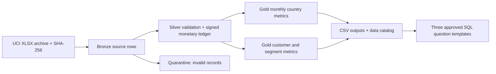

# Customer Revenue Lakehouse

A public-data module for reusable commercial BI: immutable source landing, bronze invoice lines, validated silver data, and gold revenue/customer metrics.

## Executed results

The UCI Online Retail archive supplied **541,909 invoice lines** dated December 2010 through December 2011. The build promoted **541,907 lines**, quarantined **2 negative-price adjustments**, retained **135,078 unknown-customer lines**, and reconciled **9,769,872.054 GBP** of signed transaction value across **38 countries**. All **15 data/rebuild checks** and **7 unit tests** passed. Exact source hash, totals and check results are in `outputs/validation_report.json`.

The incomplete December 2011 window is flagged explicitly for month-over-month comparisons.

## Architecture



The engine runs in **Python/pandas + SQLite** with bronze/silver/gold medallion layers and includes a Databricks SQL/Delta adapter in `databricks_handoff.sql`. The CSV catalog documents asset owners, grains, lineage, access policies and refresh behavior.

## Reproduce

```bash
cd customer_revenue_lakehouse
python -m pip install -r requirements.txt
python pipeline.py --archive data/online_retail.zip --output outputs
python -m unittest -v test_pipeline.py
python ask.py 'revenue by customer segment'
```

The pipeline downloads the archive if absent. Keep `data/` and the generated SQLite database local. The normalized CSV is a portable handoff input; the compact validation, catalog, question examples and gold aggregates are versioned. A full rebuild replaces tables and verifies identical ordered gold outputs, avoiding append duplicates.

## Analytical contract

- Grain: one source workbook row, with Excel row number as the lineage key. An invoice identifier is not a line-level primary key.
- Money: convert GBP to integer **mills** (0.001 GBP), retaining fractional pennies. `net_mills = SUM(Quantity × price_mills)`. Convert to GBP only for display.
- Positive quantities contribute to gross value; negative quantities contribute signed credits. Cancellation identifiers remain visible. Zero-price rows are retained but excluded from purchase-invoice counts. These definitions are not a refund-matching model.
- Negative prices and missing critical keys/dates are quarantined; their row count remains reconciled with the source. No source rows disappear silently.
- Missing customer identity remains in overall revenue, and appears in an explicit unknown bucket. Known-customer counts do not include unknown identities.
- Identical-looking records are flagged rather than automatically deleted so repeated purchases remain in the source-preserving ledger.
- Customer segments use deterministic rank by net value with customer ID as a tie-breaker.
- The approved question router executes three fixed, visible SQL templates.

## Validation and business acceptance

The check suite covers source-row conservation, source-key uniqueness, quarantine conservation, negative-price exclusion, independent Decimal ledger reconciliation, monthly/country and customer/unknown reconciliation, join cardinality, signed value arithmetic, output grain, customer keys, segment coverage, duplicate retention, approved question execution, and repeat-build idempotence.

The unit tests exercise fractional pennies, credits, duplicate-looking records, missing customer identity, negative prices, schema drift, month boundaries, repeated builds and unsupported questions. Expected totals are calculated from fixture inputs rather than copied from production outputs.

For a business handoff, review `docs/business_handoff.md`: decision questions, metric definitions, acceptance criteria, refresh parameters, and a training exercise.

## Sources and licenses

- Primary, executed: [Daqing Chen (2015), Online Retail, UCI](https://archive.ics.uci.edu/dataset/352/online+retail), DOI [10.24432/C5BW33](https://doi.org/10.24432/C5BW33), CC BY 4.0. Direct archive: <https://archive.ics.uci.edu/static/public/352/online%2Bretail.zip>.
- Backup: [Online Retail II](https://archive.ics.uci.edu/dataset/502/online+retail+ii), 1,067,371 source rows across two years. Its original headers use the documented rename adapter.
- Design references: [Databricks medallion layers](https://docs.databricks.com/aws/en/lakehouse/medallion) and [Unity Catalog concepts](https://docs.databricks.com/aws/en/data-governance/unity-catalog/).
