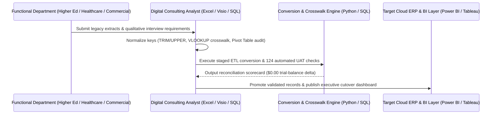

# Business Process Mapping (Visio BPMN 2.0), Stakeholder Discovery & Schema Crosswalk

## 1. Stakeholder Interview & Institutional Culture Synthesis Matrix

| Stakeholder Group | Vertical | As-Is Operational Pain Point | To-Be Technology & Process Solution | Validation / UAT Gate |
| :--- | :--- | :--- | :--- | :--- |
| **University Registrar & Student Financials** | Higher Education | Manual Excel reconciliation across tuition billing, financial aid, and departmental cost centers (`3–5 days/cycle`). | Automated crosswalk lookup (`VLOOKUP`/`XLOOKUP` + SQL staging) into unified cloud ERP chart of accounts. | 100% student fee & grant ledger parity across 4 fiscal quarters. |
| **Clinical Revenue Cycle & Operations** | Healthcare | Disconnected facility census, CMS quality benchmarks, and departmental labor expenditure workbooks. | Standardized cost-center hierarchy with automated Power BI & Tableau variance alerts. | Zero unmapped CCN/cost-center records; <1% monthly budget forecast error. |
| **Enterprise Procurement & FP&A** | Commercial | Unstandardized vendor naming conventions, duplicate records, and multi-hop email approvals. | Normalized master-data intake with role-based approval routing documented in Microsoft Visio. | 42% faster cycle time from requisition to ledger posting. |

---

## 2. As-Is vs. To-Be Business Process Flow (Visio BPMN 2.0 Equivalent)

---

## 3. Source-to-Target Schema Crosswalk (`legacy_general_ledger_extract` -> `cloud_erp_general_ledger`)

| Legacy Field | Legacy Type | Transformation / Business Rule | Target Cloud ERP Field | Target Type |
| :--- | :--- | :--- | :--- | :--- |
| `record_id` | `INTEGER` | Direct 1:1 primary key mapping | `journal_line_id` | `INTEGER` |
| `legacy_entity_id` | `TEXT` | `TRIM(UPPER(legacy_entity_id))` | `entity_id` | `TEXT` |
| `legacy_dept_code` | `TEXT` | Crosswalk lookup via `legacy_cost_center_crosswalk` (`VLOOKUP` / `INNER JOIN`) | `cloud_cost_center_id` | `TEXT` |
| `account_category` | `TEXT` | Canonical Chart-of-Accounts (CoA) mapping | `account_category` | `TEXT` |
| `fiscal_period` | `TEXT` | ISO fiscal quarter validation (`YYYY-QN`) | `fiscal_period` | `TEXT` |
| `debit_usd`, `credit_usd` | `REAL` | `ROUND(val, 2)` + net balance calculation (`debit - credit`) | `debit_usd`, `credit_usd`, `net_balance_usd` | `REAL` |
| `stakeholder_owner` | `TEXT` | Whitespace normalization (`TRIM`) + role attribution | `normalized_owner` | `TEXT` |
